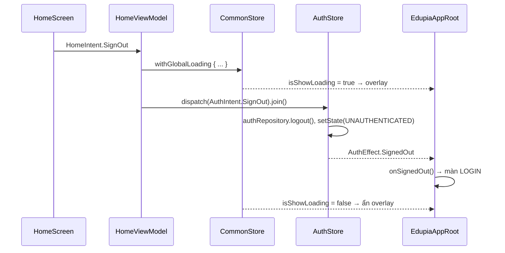

# Edupia App → Android Compose: kiến trúc & AuthBloc/CommonBloc bao toàn app

Port `mass_product_app/hybrid_app` (Flutter + BLoC + GetIt) sang Android Compose, giữ Clean Architecture.

> **Không dùng lớp contract** (`app_contracts`, adapter). Bên Flutter contract tồn tại để tách package giữa các sản phẩm (`edupia_ai`, `edupia_tutor`…). App Android này là một sản phẩm, một module → màn hình dùng **trực tiếp** `AuthStore` / `CommonStore`.

Tóm tắt: **`AuthBloc`/`CommonBloc` (`@lazySingleton`) → `AuthStore`/`CommonStore` là store MVI singleton trong `AppContainer` (State + Intent + Effect, kế thừa `BaseStore`). `MultiBlocProvider` → `AppStateProvider` (CompositionLocal). `BlocListener`/`BlocBuilder` ở `MyApp` → `EdupiaAppRoot` (collect Effect / State).**

## 0. MVI ở hai tầng

```text
      ┌──────────── Tầng app-wide (sống theo process) ─────────────┐
      │  BaseStore<S, I, E>   (core/base/BaseStore.kt)              │
      │   AuthStore   : AuthState   / AuthIntent   / AuthEffect     │
      │   CommonStore : CommonState / CommonIntent / CommonEffect   │
      └───────▲──────────────────────────┬──────────────────────────┘
   dispatch(Intent)                state / effect
      ┌───────┴──────────────────────────▼──────────────────────────┐
      │  BaseViewModel<S, I, E>  (tầng màn hình, viewModelScope)     │
      │   HomeViewModel : HomeState / HomeIntent / HomeEffect        │
      └───────▲──────────────────────────┬──────────────────────────┘
   sendIntent(Intent)              uiState / effect
      ┌───────┴──────────────────────────▼──────────────────────────┐
      │  Composable (HomeScreen)                                     │
      └──────────────────────────────────────────────────────────────┘
```

Một vòng MVI của store:

```text
dispatch(AuthIntent.SignOut) ─► handleIntent ─► repository.logout()
                                     ├─► setState { AuthState(UNAUTHENTICATED) } ─► state: StateFlow
                                     └─► sendEffect(AuthEffect.SignedOut) ───────► effect: Channel ─► root ⇒ Login
```

| Thành phần | Store app-wide | ViewModel màn hình |
|---|---|---|
| Base class | `BaseStore` | `BaseViewModel` |
| Cửa vào | `dispatch(intent): Job` (có thể `join()`) | `sendIntent(intent)` |
| State | `state: StateFlow<S>`, đổi qua `setState { copy() }` | `uiState`, `setState { copy() }` |
| Effect | `effect` (Channel) — chỉ `EdupiaAppRoot` collect | `effect` — màn hình collect |
| Scope | `AppContainer.applicationScope` | `viewModelScope` |
| File contract MVI | `AuthContract.kt`, `CommonContract.kt` | `HomeContract.kt`, `LoginContract.kt`… |

Intent / Effect hiện có:

```text
AuthIntent   : InitLoad · LoadUser · LoadLicenses · RefreshToken · SignInSucceeded(user, profiles)
               SetProfile(profile) · SwitchProfileSucceeded(profile) · SignOut
AuthEffect   : SignedOut
CommonIntent : Init · ChangeLoading(isShow) · RequestListenISpeak · OffMicISpeak
               ResetMicForNewQuestion · SetEnableOnboarding(enable)
CommonEffect : ShowMessage(message)
```

---

## 1. Ánh xạ Flutter → Android

| Flutter | Android (code hiện tại) |
|---|---|
| `GetIt appDi` + `configureDependencies()` | `AppContainer` (DI thủ công, `by lazy`), tạo ở `EdupiaApplication` |
| `@lazySingleton AuthBloc` / `AuthState` | `AuthStore` / `AuthState` — `core/appstate/auth/` |
| `@lazySingleton CommonBloc` / `CommonState` | `CommonStore` / `CommonState` — `core/appstate/common/` |
| `BlocProvider.value(appDi<AuthBloc>())` | `AppContainer.authStore` (1 instance) |
| `MultiBlocProvider` ở `MyApp` | `AppStateProvider` → `LocalAuthStore`, `LocalCommonStore` |
| Method của `AuthBloc` (`signOut()`, `loadUser()`…) | `AuthIntent` (`SignOut`, `LoadUser`…) qua `dispatch` |
| `BlocListener<AuthBloc>` ở root | `EdupiaAppRoot` collect `authStore.effect` (`SignedOut` → Login) |
| `BlocBuilder<CommonBloc>(buildWhen: isShowLoading)` | `commonStore.state.map{isShowLoading}.distinctUntilChanged()` |
| `Stack[MaterialApp, loading]` | `Box { content(); if (loading) GlobalLoadingOverlay() }` |
| `context.read<AuthBloc>().signOut()` | ViewModel `authStore.dispatch(AuthIntent.SignOut)` |
| Cubit màn hình listen `AuthBloc.stream` | `BaseViewModel` collect `authStore.state` trong `viewModelScope` |
| `Cubit.close()` cancel subscription | `viewModelScope` tự huỷ |
| `emit(state.copyWith(...))` | `setState { copy(...) }` |

---

## 2. Cấu trúc thư mục

```text
com.example.fitness.myapplication
├─ EdupiaApplication.kt        tạo AppContainer                       (≈ bootstrap)
├─ MainActivity.kt             setContent { EdupiaAppRoot { màn hình } }
├─ EdupiaAppRoot.kt            provider + listener auth + loading toàn app  (≈ MyApp)
│
├─ core/
│  ├─ di/AppContainer.kt       applicationScope, repo, authStore, commonStore  (≈ appDi)
│  ├─ appstate/                ★ state bao toàn app
│  │  ├─ AppStateProvider.kt   LocalAuthStore / LocalCommonStore         (≈ MultiBlocProvider)
│  │  ├─ auth/AuthContract.kt     AuthState / AuthIntent / AuthEffect
│  │  ├─ auth/AuthStore.kt        handleIntent → reducer + effect
│  │  ├─ common/CommonContract.kt CommonState / CommonIntent / CommonEffect
│  │  └─ common/CommonStore.kt    handleIntent + extension withGlobalLoading
│  ├─ base/                    BaseStore (MVI app-wide), BaseViewModel (MVI màn hình)
│  ├─ network/ local/ model/   data source, DTO, ApiResult, AppException
│  ├─ repository/              AuthRepository, UserRepository…           (data layer)
│  └─ designsystem/            theme, component
│
└─ feature/
   ├─ splash/                  dispatch(CommonIntent.Init).join() → dispatch(AuthIntent.InitLoad).join()
   ├─ auth/login/              login OK → dispatch(AuthIntent.SignInSucceeded(user, profiles))
   ├─ home/                    ví dụ: đọc authStore.state, signOut qua global loading
   └─ ...
```

Layer (Clean Architecture):

```text
UI (Composable)  ──intent──►  ViewModel  ──►  AuthStore / CommonStore  ──►  Repository  ──►  API / Prefs
      ▲                          │                    │
      └────── uiState ◄──────────┘◄─── StateFlow ─────┘
```

---

## 3. Hình thái "Bloc bao toàn app"

```text
┌──────────────────────────── Process ───────────────────────────────┐
│ EdupiaApplication                                                   │
│  └─ AppContainer (singleton)                                        │
│       ├─ applicationScope  (SupervisorJob + Default)                │
│       ├─ authStore    ── StateFlow<AuthState>     ≈ AuthBloc        │
│       └─ commonStore  ── StateFlow<CommonState>   ≈ CommonBloc      │
│                │ cùng 1 instance                                    │
│  MainActivity  ▼                                                    │
│  └─ EdupiaAppRoot(authStore, commonStore)          ≈ MyApp          │
│       ├─ AppStateProvider ............ ≈ MultiBlocProvider          │
│       ├─ LaunchedEffect(auth status) . ≈ BlocListener<AuthBloc>     │
│       └─ Box                                                        │
│           ├─ AnimatedContent(screen)                                │
│           │    ├─ Splash ─ SplashViewModel(authStore, commonStore)  │
│           │    ├─ Login  ─ LoginViewModel(authRepo, authStore)      │
│           │    └─ Home   ─ HomeViewModel(authStore, commonStore)    │
│           └─ GlobalLoadingOverlay ... ≈ BlocBuilder<CommonBloc>     │
└─────────────────────────────────────────────────────────────────────┘
```

Vì sao store **không phải ViewModel**: ViewModel sống theo màn/Activity, mỗi chỗ có thể ra một instance khác nhau (giống lỗi `BlocProvider(create:)`). Store singleton sống theo process nên ViewModel, Worker, Service, FCM receiver đều dùng chung được.

Hai cách đọc state:

```kotlin
// 1) ViewModel (khuyến nghị cho màn hình) — map sang state riêng của màn
class HomeViewModel(private val authStore: AuthStore, private val commonStore: CommonStore) : BaseViewModel<...>() {
    init {
        viewModelScope.launch {
            authStore.state.map { HomeState(profileName = it.currentProfile.name, ...) }
                .distinctUntilChanged()
                .collect { mapped -> setState { mapped } }
        }
    }
    // action app-wide = dispatch intent
    is HomeIntent.SignOut -> commonStore.withGlobalLoading { authStore.dispatch(AuthIntent.SignOut).join() }
}

// 2) Composable nhỏ đọc thẳng (≈ BlocBuilder trong widget) — chỉ đọc, không gọi action có logic
@Composable fun AppVersionLabel() {
    val common by LocalCommonStore.current.state.collectAsStateWithLifecycle()
    Text("Phiên bản ${common.currentVersion}")
}
```

---

## 4. Luồng

### Mở app (≈ `CommonBloc.init()` + `AuthBloc.initLoad()`)

```text
SplashViewModel.init
  → commonStore.dispatch(CommonIntent.Init).join()   → dispatch(AuthIntent.RefreshToken) (TODO: config, grades, saveLog)
  → authStore.dispatch(AuthIntent.InitLoad).join()
       ├─ chưa có token   → status = UNAUTHENTICATED
       └─ có token        → loadUser() → loadLicenses() → status = AUTHENTICATED
                            (loadUser lỗi & không có profile → UNAUTHENTICATED)
  → giữ Splash ≥ 1.5s → effect NavigateToHome | NavigateToLogin
```

### Đăng nhập

```text
LoginViewModel → authRepository.login()  (lưu token)
              → authStore.dispatch(AuthIntent.SignInSucceeded(user, profiles))
                   status = AUTHENTICATED, ghim currentProfile, loadLicenses (chạy trên scope của store)
              → effect NavigateToHome
```

### Đăng xuất từ bất kỳ đâu



Màn hình **không tự điều hướng về Login** sau khi đăng xuất; root nhận `AuthEffect.SignedOut` (giống `BlocListener<AuthBloc>`), nên sau này xử lý 401/hết phiên chỉ cần `authStore.dispatch(AuthIntent.SignOut)`.

### Global loading

```text
bất kỳ ViewModel: commonStore.dispatch(CommonIntent.ChangeLoading(true))  hoặc  commonStore.withGlobalLoading { ... }
  → CommonState.isShowLoading
  → EdupiaAppRoot: map + distinctUntilChanged → GlobalLoadingOverlay (chặn touch)
```

---

## 5. Quy ước

- Chỉ tạo store trong `AppContainer`, không `AuthStore(...)` ở chỗ khác.
- ViewModel nhận store qua constructor (`viewModel { HomeViewModel(container.authStore, ...) }`), không lấy từ `LocalAuthStore`.
- Composable dùng `LocalAuthStore`/`LocalCommonStore` chỉ để **đọc**.
- Store chỉ có một cửa vào là `dispatch(intent)`; hàm xử lý bên trong để `private`.
- State chỉ đổi qua `setState { copy(...) }`; không giữ `Context`/`Activity` trong store.
- Cần chờ kết quả → `dispatch(...).join()` rồi đọc `currentState`.
- Intent của store chạy trên `applicationScope` nên không bị huỷ khi màn đóng.
- Effect của store (Channel) **chỉ root collect**. Event riêng của màn (toast, navigate) → effect của ViewModel.
- Process death: store khởi tạo rỗng, nên màn bắt đầu luôn là Splash (`remember`, không `rememberSaveable`) để `initLoad()` dựng lại phiên từ token đã lưu.

## 6. Việc còn lại

- Port thêm vào `CommonStore.init()`: config, grades, saveLog, device info.
- Port vào `AuthStore`: consent, contest, products, tutor license (đang có trong `AuthBloc`).
- Thay `AnimatedContent` + enum bằng Navigation Compose khi số màn tăng (root listener giữ nguyên, chỉ đổi `onSignedOut` thành `navController.navigate(Login) { popUpTo(0) }`).
- Nếu sau này cần XML: store + ViewModel giữ nguyên; `MainActivity` collect `commonStore.state` bằng `repeatOnLifecycle` để bật/tắt overlay trong `activity_main.xml`.
