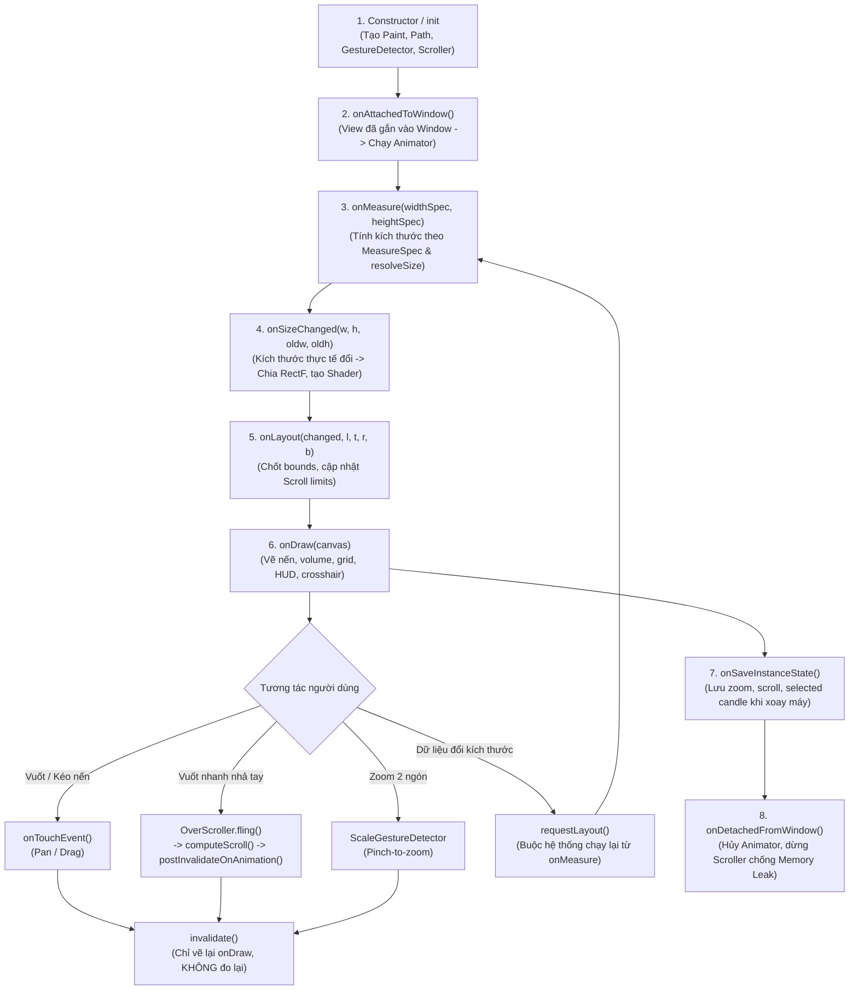

# Cẩm Nang Toàn Diện Android Custom View: Phân Tích Chuyên Sâu `CustomView.kt` Kèm Code & Use Cases

Tài liệu này phân tích chi tiết toàn bộ kiến trúc, vòng đời, kỹ thuật đồ họa 2D Canvas, tối ưu bộ nhớ, xử lý cảm ứng đa điểm và các trường hợp sử dụng (Use Cases) thực chiến được cài đặt trong file [CustomView.kt](app/src/main/java/com/example/fitness/myapplication/CustomView.kt).

---

## Mục Lục
1. [Sơ Đồ Vòng Đời & Luồng Hoạt Động (Architecture & Lifecycle Flow)](#1-sơ-đồ-vòng-đời--luồng-hoạt-động)
2. [Khởi Tạo, Constructors & Bẫy `@JvmOverloads`](#2-khởi-tạo-constructors--bẫy-jvmoverloads)
3. [Quản Lý Bộ Nhớ & Tối Ưu GC Trong `onDraw()`](#3-quản-lý-bộ-nhớ--tối-ưu-gc-trong-ondraw)
4. [Gắn/Gỡ Window & Chống Memory Leak (`onAttached` / `onDetached`)](#4-gắngỡ-window--chống-memory-leak)
5. [Đo Đạc Kích Thước & Cơ Chế `MeasureSpec` (`onMeasure`)](#5-đo-đạc-kích-thước--cơ-chế-measurespec)
6. [Phân Vùng Bố Cục & Khởi Tạo Shader (`onSizeChanged`, `onLayout`)](#6-phân-vùng-bố-cục--khởi-tạo-shader)
7. [Kỹ Thuật Đồ Họa Canvas Chuyên Sâu (`onDraw`)](#7-kỹ-thuật-đồ-họa-canvas-chuyên-sâu)
   - [7.1. Viewport Culling (Chỉ vẽ vùng nhìn thấy)](#71-viewport-culling)
   - [7.2. Giới hạn khung vẽ `clipRect()` chống tràn Overdraw](#72-giới-hạn-khung-vẽ-cliprect)
   - [7.3. Vẽ Nến Candlestick & Cột Khối Lượng Volume](#73-vẽ-nến-candlestick--volume)
   - [7.4. Đường trung bình trượt MA7 / MA20 (Sliding Window)](#74-đường-trung-bình-trượt-ma7--ma20)
   - [7.5. Biểu đồ đường diện tích (Line Area Gradient)](#75-biểu-đồ-đường-diện-tích-line-area)
   - [7.6. Đường giá trực tiếp & Hiệu ứng Live Pulse](#76-đường-giá-trực-tiếp--live-pulse)
   - [7.7. Tia ngắm Crosshair & HUD Header](#77-tia-ngắm-crosshair--hud-header)
8. [Cảm Ứng Đa Điểm, Cử Chỉ & Cuộn Quán Tính (`onTouchEvent`)](#8-cảm-ứng-đa-điểm-cử-chỉ--cuộn-quán-tính)
   - [8.1. Bẫy Touch Dispatch & `requestDisallowInterceptTouchEvent`](#81-bẫy-touch-dispatch)
   - [8.2. Thu phóng 2 ngón (Pinch-to-Zoom) neo tại tâm điểm](#82-thu-phóng-2-ngón-neo-tại-tâm-điểm)
   - [8.3. Cuộn quán tính 120 FPS (`OverScroller` + `computeScroll`)](#83-cuộn-quán-tính-120-fps)
9. [Vòng Đời Hiển Thị & Tiết Kiệm Pin (`onVisibilityChanged`, Focus)](#9-vòng-đời-hiển-thị--tiết-kiệm-pin)
10. [Bảo Lưu Trạng Thái Khi Xoay Màn Hình (`SavedState`)](#10-bảo-lưu-trạng-thái-khi-xoay-màn-hình)
11. [Chuyển Đổi Đơn Vị & Non-linear Font Scaling Trên Android 14+](#11-chuyển-đổi-đơn-vị--android-14)
12. [Hướng Dẫn Tích Hợp (XML Layout & Jetpack Compose)](#12-hướng-dẫn-tích-hợp)

---

## 1. Sơ Đồ Vòng Đời & Luồng Hoạt Động

Vòng đời của một Android Custom View diễn ra theo trình tự nghiêm ngặt từ lúc khởi tạo, gắn vào cửa sổ, đo kích thước, bố cục, vẽ từng khung hình cho đến khi bị gỡ bỏ:



### So Sánh Cốt Lõi: `invalidate()` vs `requestLayout()`
| Đặc điểm | `invalidate()` | `requestLayout()` |
| :--- | :--- | :--- |
| **Hàm kích hoạt** | Chỉ gọi lại `onDraw()`. | Buộc hệ thống gọi lại: `onMeasure()` $\rightarrow$ `onSizeChanged()` $\rightarrow$ `onLayout()` $\rightarrow$ `onDraw()`. |
| **Chi phí hiệu năng** | Rất nhẹ (chỉ vẽ lại pixel trên Canvas). | Nặng (tính toán lại toàn bộ cây layout phân cấp của ViewGroup). |
| **Use Case thực tế** | Thay đổi màu sắc, cập nhật nến mới, đổi chế độ nến sang đường, animation chạy từng frame. | Thay đổi kích thước View (`layout_width`, `layout_height`), đổi padding/margin, đổi font chữ làm phình kích thước. |

---

## 2. Khởi Tạo, Constructors & Bẫy `@JvmOverloads`

### Đoạn Code Cốt Lõi:
```kotlin
class CustomView @JvmOverloads constructor(
    context: Context,
    attrs: AttributeSet? = null,
    defStyleAttr: Int = 0
) : View(context, attrs, defStyleAttr) {

    init {
        // [CÂU #009]: 2 điều kiện bắt buộc để hệ thống tự kích hoạt onSaveInstanceState
        if (id == NO_ID) {
            id = generateViewId()
        }
        isSaveEnabled = true

        // [CÂU #008]: Hỗ trợ người dùng khiếm thị (TalkBack / Accessibility)
        isFocusable = true
        contentDescription = "Biểu đồ chứng khoán FPT. Vuốt 1 ngón để cuộn, 2 ngón để zoom, chạm để tra cứu giá."
    }
}
```

### Bẫy Phỏng Vấn (Gotcha):
> [!WARNING]
> **Bẫy của `@JvmOverloads`**:
> Khi dùng `@JvmOverloads`, Kotlin sinh ra 3 constructors: `(Context)`, `(Context, AttributeSet)`, `(Context, AttributeSet, defStyleAttr)`.
> Với tham số thứ 3, Kotlin tự động điền giá trị mặc định là `defStyleAttr = 0`.
> - **An toàn**: Kế thừa trực tiếp lớp `View` (vì `View` không có style hệ thống mặc định).
> - **CỰC KỲ NGUY HIỂM**: Nếu kế thừa widget hệ thống như `androidx.appcompat.widget.AppCompatButton`, `EditText`, `Switch`... Những widget này dựa vào `defStyleAttr` (ví dụ `R.attr.buttonStyle`) để nạp background, padding, ripple effect và font. Truyền `0` sẽ làm **mất hoàn toàn giao diện mặc định** của nút bấm!

### Các Case Sử Dụng:
- **Case 1 (Tạo qua Code Kotlin)**: `val chart = CustomView(context)` $\rightarrow$ Gọi constructor 1 tham số.
- **Case 2 (Khai báo trong XML)**: `<com.example...CustomView android:layout_width="match_parent"... />` $\rightarrow$ Hệ thống Android gọi constructor 2 tham số `(Context, AttributeSet)`.
- **Case 3 (Áp dụng Style riêng từ Theme)**: `CustomView(context, attrs, R.attr.customChartStyle)` $\rightarrow$ Gọi constructor 3 tham số.

---

## 3. Quản Lý Bộ Nhớ & Tối Ưu GC Trong `onDraw()`

### Đoạn Code Cốt Lõi:
```kotlin
// CẤP PHÁT SẴN TRONG KHỞI TẠO (TRÁNH GC TRASHING)
private val bgPaint = Paint().apply {
    color = Color.parseColor("#0F172A")
    style = Paint.Style.FILL
}
private val bullPaint = Paint(Paint.ANTI_ALIAS_FLAG).apply {
    color = Color.parseColor("#10B981")
    style = Paint.Style.FILL
}
private val ma7Path = Path()
private val tempRect = RectF()
```

### Nguyên Lý Kỹ Thuật:
> [!CAUTION]
> **Quy tắc vàng số 1 khi lập trình Custom View**:
> **TUYỆT ĐỐI KHÔNG DÙNG `val paint = Paint()` hoặc `val rect = RectF()` TRONG HÀM `onDraw()`!**
> `onDraw()` được gọi 60 đến 120 lần mỗi giây khi cuộn hoặc chạy animation. Cấp phát đối tượng tại đây sẽ tạo ra hàng chục nghìn object tạm trong vài giây, làm đầy bộ nhớ Heap và kích hoạt bộ thu gom rác **Garbage Collector (GC)** liên tục. Khi GC chạy (Stop-the-world), UI Thread bị đình trệ gây ra hiện tượng **rớt khung hình (Jank/Stutter)**.

### Case Sử Dụng Thực Tế:
- **Tái sử dụng `Path`**: Gọi `ma7Path.reset()` để xóa toạ độ cũ và nạp toạ độ mới trong từng frame vẽ thay vì tạo `Path` mới.
- **Tái sử dụng `RectF`**: Dùng `tempRect.set(left, top, right, bottom)` để tính toán toạ độ vẽ badge giá/thời gian mà không tiêu tốn 1 byte RAM nào.

---

## 4. Gắn/Gỡ Window & Chống Memory Leak

### Đoạn Code Cốt Lõi:
```kotlin
override fun onAttachedToWindow() {
    super.onAttachedToWindow()
    logLifecycle("onAttachedToWindow: Gắn vào Window -> Bắt đầu Animator")
    if (!isInEditMode) {
        startIntroAnimation()
        startPulseAnimation()
    }
}

override fun onDetachedFromWindow() {
    logLifecycle("onDetachedFromWindow: Dọn dẹp chống Memory Leak")
    introAnimator?.cancel()
    introAnimator = null
    pulseAnimator?.cancel()
    pulseAnimator = null
    scroller.abortAnimation()
    super.onDetachedFromWindow()
}
```

### Case Sử Dụng & Bẫy Rò Rỉ Bộ Nhớ (Memory Leak):
- **Case 1 (Preview trong Android Studio)**: Luôn kiểm tra `if (!isInEditMode)` trước khi khởi chạy Coroutine hoặc `ValueAnimator`, tránh làm đơ Layout Editor.
- **Case 2 (Chống rò rỉ Activity Context)**: `ValueAnimator` với `repeatCount = INFINITE` sẽ chạy ngầm vĩnh viễn trên Choreographer. Nếu người dùng đóng Activity mà không gọi `animator.cancel()` tại `onDetachedFromWindow()`, Listener của Animator vẫn giữ tham chiếu mạnh (Strong Reference) đến `CustomView` $\rightarrow$ giữ `Context` $\rightarrow$ **Rò rỉ toàn bộ Activity**!

---

## 5. Đo Đạc Kích Thước & Cơ Chế `MeasureSpec` (`onMeasure`)

### Đoạn Code Cốt Lõi:
```kotlin
override fun onMeasure(widthMeasureSpec: Int, heightMeasureSpec: Int) {
    // 1. Kích thước mong muốn (desired) BẮT BUỘC phải cộng thêm padding
    val desiredWidth = dpToPx(360f).toInt() + paddingLeft + paddingRight
    val desiredHeight = dpToPx(340f).toInt() + paddingTop + paddingBottom

    // 2. resolveSize tự động phân giải kích thước theo chỉ thị từ ViewGroup cha
    val measuredW = resolveSize(desiredWidth, widthMeasureSpec)
    val measuredH = resolveSize(desiredHeight, heightMeasureSpec)

    // 3. Chốt kích thước vào hệ thống (bắt buộc)
    setMeasuredDimension(measuredW, measuredH)
}
```

### Cơ Chế 3 Chế Độ MeasureSpec (32-bit Integer):
1. **`EXACTLY`** (2 bit Mode = `01`): Cha áp đặt kích thước cố định (ví dụ `layout_width="300dp"` hoặc `match_parent` trong cha có size cố định). View con buộc phải lấy kích thước này.
2. **`AT_MOST`** (2 bit Mode = `10`): Cha đặt mức trần tối đa (ví dụ `layout_width="wrap_content"`). View con chỉ được lấy tối đa bằng kích thước cha cho phép: `minOf(desired, parentSize)`.
3. **`UNSPECIFIED`** (2 bit Mode = `00`): Cha không giới hạn trần (ví dụ View nằm trong `ScrollView` hoặc `HorizontalScrollView`). View con muốn to bao nhiêu tùy ý: lấy đúng `desired`.

### Case Sử Dụng Thực Tế & Bẫy Thường Gặp:
- **Bẫy quên Padding**: Nếu lập trình viên chỉ viết `desiredWidth = dpToPx(360f).toInt()`, khi người dùng đặt `android:padding="20dp"` trong XML, biểu đồ sẽ bị ép co rúm hoặc tràn mép do không trừ hao phần padding.
- **Bẫy `view.width == 0` trong `onCreate()`**: Trong `Activity.onCreate()`, chu kỳ đo đạc chưa diễn ra nên `view.width` luôn bằng 0. Cách lấy kích thước đúng:
  ```kotlin
  view.post {
      val actualWidth = view.width // Lúc này View đã đo xong, width > 0
  }
  ```

---

## 6. Phân Vùng Bố Cục & Khởi Tạo Shader (`onSizeChanged`, `onLayout`)

### Đoạn Code Cốt Lõi:
```kotlin
override fun onSizeChanged(w: Int, h: Int, oldw: Int, oldh: Int) {
    super.onSizeChanged(w, h, oldw, oldh)

    val contentLeft = paddingLeft + dpToPx(12f)
    val yAxisWidth = dpToPx(56f) // Dành riêng lề phải cho cột nhãn giá Y
    val contentRight = (w - paddingRight - yAxisWidth).coerceAtLeast(contentLeft + dpToPx(60f))
    val contentTop = paddingTop + dpToPx(8f)
    val contentBottom = (h - paddingBottom - dpToPx(8f)).coerceAtLeast(contentTop + dpToPx(80f))

    val totalHeight = contentBottom - contentTop
    val headerHeight = dpToPx(58f).coerceAtMost(totalHeight * 0.24f)
    val timeAxisHeight = dpToPx(24f).coerceAtMost(totalHeight * 0.12f)
    val chartsAvailableHeight = (totalHeight - headerHeight - timeAxisHeight).coerceAtLeast(dpToPx(40f))

    // Phân bổ tỷ lệ: 74% chiều cao cho Biểu đồ Nến, 26% cho Cột Khối Lượng
    val priceHeight = chartsAvailableHeight * 0.74f
    val gapBetweenCharts = dpToPx(8f)

    headerRect.set(contentLeft, contentTop, w - paddingRight - dpToPx(12f), contentTop + headerHeight)
    priceChartRect.set(contentLeft, headerRect.bottom + dpToPx(4f), contentRight, headerRect.bottom + priceHeight)
    volumeChartRect.set(contentLeft, priceChartRect.bottom + gapBetweenCharts, contentRight, contentBottom - timeAxisHeight)
    timeAxisRect.set(contentLeft, volumeChartRect.bottom, contentRight, contentBottom)

    // Tạo Shader một lần duy nhất theo kích thước thực tế
    lineAreaPaint.shader = LinearGradient(
        0f, priceChartRect.top, 0f, priceChartRect.bottom,
        Color.argb(110, 34, 211, 238),
        Color.argb(0, 34, 211, 238),
        Shader.TileMode.CLAMP
    )
}
```

### Case Sử Dụng:
- **Đáp ứng màn hình xoay ngang / gập (Foldable)**: Khi thiết bị xoay hoặc đổi kích thước cửa sổ đa nhiệm, `onSizeChanged` tự động tính lại tỷ lệ phần trăm giữa nến và khối lượng, cập nhật lại Shader tương ứng.

---

## 7. Kỹ Thuật Đồ Họa Canvas Chuyên Sâu

### 7.1. Viewport Culling
```kotlin
val step = candleStepPx()
val firstVisibleIndex = max(0, (scrollOffsetPx / step).toInt() - 1)
val visibleCount = (priceChartRect.width() / step).toInt() + 3
val lastVisibleIndex = min(candles.lastIndex, firstVisibleIndex + visibleCount)
```
- **Use Case**: Dù lịch sử cổ phiếu có 100.000 cây nến, thuật toán chỉ duyệt vòng lặp từ `firstVisibleIndex` đến `lastVisibleIndex` ($\approx 25$ nến). Biểu đồ luôn giữ vững mức 120 FPS mượt mà.

### 7.2. Giới Hạn Khung Vẽ `clipRect()`
```kotlin
canvas.save()
canvas.clipRect(
    priceChartRect.left,
    priceChartRect.top,
    priceChartRect.right,
    volumeChartRect.bottom
)
// Vẽ nến, đường MA, dải màu tại đây...
canvas.restore()
```
- **Use Case**: Khi người dùng cuộn ngang biểu đồ, các cây nến ở mép phải sẽ không bị vẽ đè tràn lên cột nhãn giá Y-Axis hoặc viền màn hình.

### 7.3. Vẽ Nến Candlestick & Volume
```kotlin
// 1. Râu nến (Line từ đỉnh High xuống đáy Low)
canvas.drawLine(cx, highY, cx, lowY, paint)

// 2. Thân nến (Hình chữ nhật Open - Close)
val topBody = min(openY, closeY)
val bottomBody = max(openY, closeY).coerceAtLeast(topBody + dpToPx(1.5f))
canvas.drawRect(cx - halfBody, topBody, cx + halfBody, bottomBody, paint)

// 3. Cột khối lượng bên dưới
val volHeight = (c.volume / maxVolume) * volumeChartRect.height() * introProgress
canvas.drawRect(cx - halfBody, volumeChartRect.bottom - volHeight, cx + halfBody, volumeChartRect.bottom, paint)
```
- **Use Case**: Đảm bảo thân nến luôn dày tối thiểu 1.5dp để không bị biến mất khi phiên giao dịch có giá Open bằng giá Close (nến Doji).

### 7.4. Đường Trung Bình Trượt MA7 / MA20
```kotlin
private fun recalculateMovingAverages() {
    ma7Values.clear()
    var sum7 = 0f
    for (i in candles.indices) {
        sum7 += candles[i].close
        if (i >= 7) sum7 -= candles[i - 7].close // Trừ phần tử lọt ra khỏi cửa sổ trượt
        ma7Values.add(if (i >= 6) sum7 / 7f else null)
    }
}
```
- **Use Case**: Thuật toán Sliding Window tính toán đường trung bình động với độ phức tạp $O(N)$ thay vì $O(N \times K)$.

### 7.5. Biểu Đồ Đường Diện Tích (Line Area)
```kotlin
areaPath.lineTo(lastX, priceChartRect.bottom)
areaPath.lineTo(firstX, priceChartRect.bottom)
areaPath.close() // Khép kín đa giác để tô LinearGradient
canvas.drawPath(areaPath, lineAreaPaint)
canvas.drawPath(linePath, linePricePaint)
```

### 7.6. Đường Giá Trực Tiếp & Live Pulse
```kotlin
val currentRadius = dpToPx(3.5f) + maxPulseRadius * livePulseFraction
pulsePaint.alpha = ((1f - livePulseFraction) * 140).toInt().coerceIn(0, 255)
canvas.drawCircle(lastX, y, currentRadius, pulsePaint)
```
- **Use Case**: Tạo vòng tròn sáng lan tỏa dạng radar nhấp nháy tại cây nến mới nhất của sàn giao dịch.

### 7.7. Tia Ngắm Crosshair & HUD Header
```kotlin
// Kẻ 2 đường nét đứt gióng ngang & gióng dọc
canvas.drawLine(cx, priceChartRect.top, cx, volumeChartRect.bottom, crosshairPaint)
canvas.drawLine(priceChartRect.left, cy, priceChartRect.right, cy, crosshairPaint)
```
- **Use Case**: Cho phép người dùng chạm giữ để soi chính xác giá trị OHLCV tại bất kỳ thời điểm nào trong quá khứ.

---

## 8. Cảm Ứng Đa Điểm, Cử Chỉ & Cuộn Quán Tính

### 8.1. Bẫy Touch Dispatch
```kotlin
override fun onTouchEvent(event: MotionEvent): Boolean {
    when (event.actionMasked) {
        MotionEvent.ACTION_DOWN -> parent?.requestDisallowInterceptTouchEvent(true)
        MotionEvent.ACTION_UP, MotionEvent.ACTION_CANCEL -> {
            parent?.requestDisallowInterceptTouchEvent(false)
        }
    }
    val scaleHandled = scaleDetector.onTouchEvent(event)
    val gestureHandled = gestureDetector.onTouchEvent(event)
    return scaleHandled || gestureHandled || super.onTouchEvent(event)
}
```
- **Use Case**: Khi biểu đồ đặt bên trong `ScrollView` hoặc `ViewPager2`, khi ngón tay chạm vào biểu đồ (`ACTION_DOWN`), ta yêu cầu View cha không được cướp quyền touch (`requestDisallowInterceptTouchEvent(true)`). Khi nhả tay (`ACTION_UP`), ta trả lại quyền cho cha.

### 8.2. Thu Phóng 2 Ngón Neo Tại Tâm Điểm
```kotlin
val oldStep = candleStepPx()
val focusX = detector.focusX - priceChartRect.left
val centerCandleFloat = (scrollOffsetPx + focusX) / oldStep

candleWidthPx = (candleWidthPx * detector.scaleFactor).coerceIn(minCandleWidthPx, maxCandleWidthPx)
candleSpacingPx = (candleWidthPx * 0.28f).coerceAtLeast(dpToPx(2f))
updateScrollBounds()

// Giữ nguyên cây nến ngay dưới tâm 2 ngón tay
val newStep = candleStepPx()
scrollOffsetPx = (centerCandleFloat * newStep - focusX).coerceIn(0f, maxScrollOffsetPx)
invalidate()
```
- **Use Case**: Khi người dùng đặt 2 ngón tay zoom vào một cây nến cụ thể, cây nến đó đứng yên tại vị trí giữa 2 ngón tay, biểu đồ không bị trôi lệch sang chỗ khác.

### 8.3. Cuộn Quán Tính 120 FPS
```kotlin
// 1. Khi phát hiện vuốt nhanh (Fling):
override fun onFling(e1: MotionEvent?, e2: MotionEvent, velocityX: Float, velocityY: Float): Boolean {
    scroller.fling(scrollOffsetPx.toInt(), 0, (-velocityX).toInt(), 0, 0, maxScrollOffsetPx.toInt(), 0, 0)
    postInvalidateOnAnimation()
    return true
}

// 2. Hệ thống tự gọi computeScroll() mỗi frame VSYNC:
override fun computeScroll() {
    super.computeScroll()
    if (scroller.computeScrollOffset()) {
        scrollOffsetPx = scroller.currX.toFloat().coerceIn(0f, maxScrollOffsetPx)
        postInvalidateOnAnimation()
    }
}
```
- **Use Case**: Tái tạo cảm giác cuộn mượt mà có ma sát vật lý giống hệt danh sách của iOS và Android native.

---

## 9. Vòng Đời Hiển Thị & Tiết Kiệm Pin

```kotlin
override fun onVisibilityChanged(changedView: View, visibility: Int) {
    super.onVisibilityChanged(changedView, visibility)
    if (visibility == VISIBLE) {
        pulseAnimator?.resume()
    } else {
        pulseAnimator?.pause()
    }
}

override fun onWindowFocusChanged(hasWindowFocus: Boolean) {
    super.onWindowFocusChanged(hasWindowFocus)
    if (hasWindowFocus && visibility == VISIBLE) {
        pulseAnimator?.resume()
    } else {
        pulseAnimator?.pause()
    }
}
```
- **Use Case**: Khi người dùng chuyển tab, mở Dialog, hoặc bấm Home ra màn hình chính, hoạt ảnh nhấp nháy lập tức được tạm dừng (`pause`), giúp thiết bị không bị nóng máy và tiết kiệm pin tối đa.

---

## 10. Bảo Lưu Trạng Thái Khi Xoay Màn Hình

```kotlin
override fun onSaveInstanceState(): Parcelable {
    val superState = super.onSaveInstanceState()
    return SavedState(superState).apply {
        savedCandleWidth = this@CustomView.candleWidthPx
        savedScrollOffset = this@CustomView.scrollOffsetPx
        savedSelectedIndex = this@CustomView.selectedCandleIndex
        savedCrosshairActive = this@CustomView.isCrosshairActive
        savedChartModeOrdinal = this@CustomView.chartMode.ordinal
    }
}

override fun onRestoreInstanceState(state: Parcelable?) {
    if (state is SavedState) {
        super.onRestoreInstanceState(state.superState)
        candleWidthPx = state.savedCandleWidth
        scrollOffsetPx = state.savedScrollOffset
        selectedCandleIndex = state.savedSelectedIndex
        isCrosshairActive = state.savedCrosshairActive
        chartMode = ChartMode.entries[state.savedChartModeOrdinal]
        invalidate()
    } else {
        super.onRestoreInstanceState(state)
    }
}
```
- **Use Case**: Khi người dùng đang soi giá ở chế độ màn hình dọc rồi xoay ngang điện thoại để xem biểu đồ rộng hơn, vị trí cây nến đang chọn, mức độ zoom và vị trí cuộn vẫn được giữ nguyên vẹn 100%.

---

## 11. Chuyển Đổi Đơn Vị & Non-linear Font Scaling Trên Android 14+

```kotlin
private fun dpToPx(dp: Float): Float =
    TypedValue.applyDimension(TypedValue.COMPLEX_UNIT_DIP, dp, resources.displayMetrics)

private fun spToPx(sp: Float): Float =
    TypedValue.applyDimension(TypedValue.COMPLEX_UNIT_SP, sp, resources.displayMetrics)
```

### Bẫy Phỏng Vấn (Android 14+ Feature):
> [!NOTE]
> Từ **Android 14 (API 34)**, hệ thống áp dụng cơ chế **Non-linear Font Scaling** (chữ nhỏ phóng to nhanh, chữ to phóng to chậm để tránh vỡ bố cục).
> - **Sai lầm phổ biến**: `sp * displayMetrics.scaledDensity` (tính nhẩm tuyến tính sai hoàn toàn trên Android 14+).
> - **Cách duy nhất chuẩn mực**: Phải dùng `TypedValue.applyDimension(COMPLEX_UNIT_SP, ...)`!

---

## 12. Hướng Dẫn Tích Hợp

### Cách 1: Sử Dụng Trong XML Layout Cổ Điển
```xml
<com.example.fitness.myapplication.CustomView
    android:id="@+id/stockChart"
    android:layout_width="match_parent"
    android:layout_height="360dp"
    android:padding="8dp" />
```

### Cách 2: Nhúng Vào Jetpack Compose (Bằng `AndroidView`)
```kotlin
@Composable
fun StockChartScreen() {
    var chartMode by remember { mutableStateOf(CustomView.ChartMode.CANDLESTICK) }

    AndroidView(
        modifier = Modifier
            .fillMaxWidth()
            .height(370.dp),
        factory = { context ->
            CustomView(context).apply {
                layoutParams = ViewGroup.LayoutParams(
                    ViewGroup.LayoutParams.MATCH_PARENT,
                    ViewGroup.LayoutParams.MATCH_PARENT
                )
                onLifecycleEvent = { event ->
                    println("Lifecycle: $event")
                }
            }
        },
        update = { view ->
            // Được gọi mỗi khi state chartMode thay đổi
            view.chartMode = chartMode
        },
        onRelease = { view ->
            // Dọn dẹp tài nguyên khi rời khỏi màn hình Compose
        }
    )
}
```
